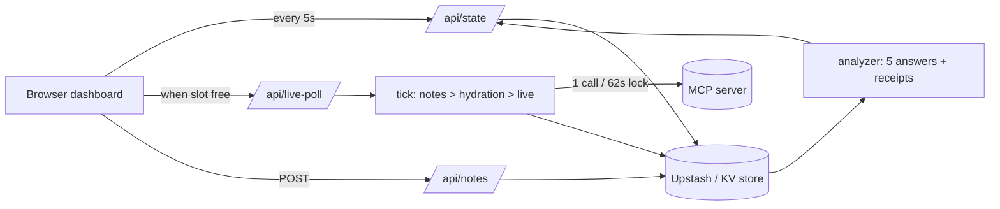

# Account Quest CRM

Five-question account intelligence for two accounts (Eastern Counties Police Alliance, Aldermoor Industrial Group). Every number and claim carries a receipt (`person_id`, `deal_id`, `fact_id`, `file_id`, paperwork `path`, or signal). No login; open the Vercel URL in any incognito window.

## Quick start

```bash
npm install
cp .env.example .env.local      # set AQ_TOKEN=...
npm run dev                     # http://localhost:3000
```

Open the page and leave it open. Hydration makes 7 MCP calls, one every ~62 s (about 7 minutes), then switches to live polling.

## Deploy (Vercel)

1. Push to GitHub, import the repo in Vercel.
2. Env vars: `AQ_TOKEN` (required). Add the **Upstash Redis** integration (Storage tab) so the cache persists across serverless invocations; its env vars are auto-detected.
3. Deploy. Visit the URL once to start hydration.

Without Upstash the app falls back to `/tmp` (warm instances only) and shows a warning in the status bar.

## Architecture



- `lib/mcp.ts`: exact JSON-RPC call, JSON/SSE parsing, global 62 s lock (atomic `SET NX PX`). Throws instead of sleeping.
- `lib/store.ts`: Upstash REST, `/tmp` file or memory; cache, meta, notes, signal log.
- `lib/plan.ts`: `tick()` scheduler (one MCP call max per beat), hydration plan, signal merge, note sending.
- `lib/analyzer.ts`: deterministic rules; no LLM, no invented IDs.
- `AQ_TOKEN` is read only in `lib/mcp.ts` (server). It never reaches the client or the repo.

## Endpoints

| Route | Purpose |
|---|---|
| `GET /api/state` | Cached state + analysis (`?debug=1` adds raw MCP payloads). Never calls MCP. |
| `GET /api/live-poll` | One scheduler beat. |
| `GET/POST /api/hydrate` | Status / next hydration step / `{force,tool,args}` refetch. |
| `GET/POST /api/notes` | List / queue a note (`{retry:id}` re-queues). |

## First-run checklist

- [ ] `npm run build` passes
- [ ] After hydration, open `/api/state?debug=1`; compare `analysis.schema` with the real payload and fix aliases in `lib/analyzer.ts` if records are missing
- [ ] Status bar shows `store: upstash` on Vercel
- [ ] Q1 totals: Backed and Unbacked are separate; each deal expands to receipts
- [ ] Send one test note and confirm `queued -> synced`
